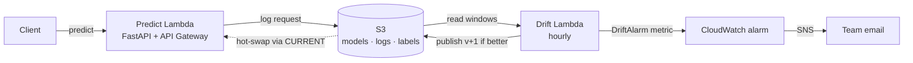
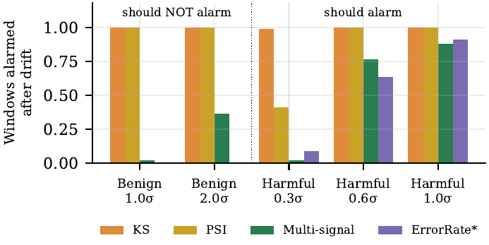
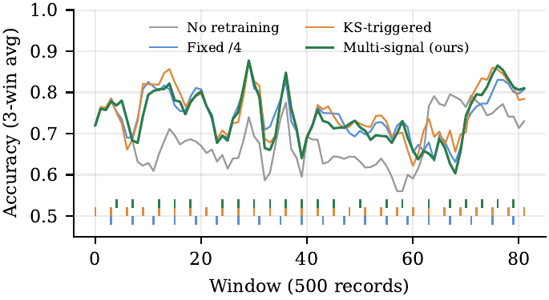

# MLOps Pipeline — AutoML + Deployment + Monitoring

A low-cost, closed-loop MLOps pipeline that keeps a deployed model accurate on its own.
It selects a model with AutoML, serves it on AWS Lambda, logs every prediction to S3, detects data drift with a **multi-signal detector**, retrains automatically, ships the new model **only if it is better**, and alerts the team by email.

> Course project — *Advanced Cloud & Research Trends* (CIE 3), RV University, Bengaluru.

---

## How it works



1. **Serve** — a FastAPI app on Lambda answers `/predict` and logs each request to S3.
2. **Detect** — every hour a drift Lambda checks windows of 500 logged predictions.
3. **Retrain** — on confirmed drift, warm-started AutoML (FLAML) trains a candidate on the newest labelled data.
4. **Gate** — the candidate is published as `v+1` only if it matches or beats the serving model on the newest 20% of data.
5. **Swap** — the API rereads the `models/CURRENT` pointer every 30 s and switches models with no redeploy.
6. **Alert** — a CloudWatch alarm on the `DriftAlarm` metric emails the team through SNS.

### Multi-signal drift detector

| Signal | Fires when |
|---|---|
| S1 · Input shift | ≥ 25% of features shift on both a KS test (Bonferroni) and PSI > 0.2 |
| S2 · Prediction shift | PSI of predicted probabilities > 0.1 |
| S3 · Confidence drop | Mean prediction confidence falls by > 0.05 |

A window votes *drift* when **2 of 3** signals fire; an alarm needs **2 drift windows in a row**.
A shift in a feature the model ignores moves only S1, so it cannot trigger a retrain on its own.

---

## Results

| Experiment | Result |
|---|---|
| Controlled drift, 20 seeds | Harmless shift: KS and PSI alarmed on **100%** of windows, ours on **2%**. Harmful shift caught in **95%** of runs within ~1 window |
| Elec2 real data, 3 runs | Static model **67.8%**. Ours **74.4%** with **19% fewer retrains** than KS/PSI (74.7% / 74.6%, 28 retrains) |
| Live HTTP loop, 20,000 requests | 9 alarms, 6 models promoted, 3 rejected by the gate; median **6.5 s** alarm → serving; **76.2%** vs 68.0% static |
| AWS deployment (ap-south-1) | v1 Extra Trees → drift alarm → retrained in Lambda in **13 s** → XGBoost **83.0% vs 78.8%** promoted to v2, SNS email sent |

<p align="center">
  
  
</p>

Full method and results: [`paper/main.pdf`](paper/main.pdf) (IEEE conference format).

---

## Repository structure

```
src/
  automl.py      FLAML search, warm-started retrain + deployment gate
  drift.py       KS, PSI, error-rate baselines + MultiSignalDetector
  api.py         FastAPI: /predict, /feedback, /health (hot-swaps models)
  monitor.py     Drift job and retrain_from_store
  registry.py    Versioned model registry + logs (local folder or S3, same API)
  pipeline.py    CLI: train | retrain | monitor
  data.py        Elec2 loader, synthetic data, drift injection
infra/
  template.yaml        AWS SAM template (S3, 2 Lambdas, HTTP API, schedule, alarm, SNS)
  lambda_handlers.py   Lambda entry points (API + drift job)
  Dockerfile           Lambda container image
experiments/     exp1 Elec2 · exp2 controlled drift · exp3 live loop · replay_cloud · make_figures
tests/           Unit + end-to-end tests (drift → retrain → hot-swap)
.github/workflows/   CI (tests, cfn-lint) · CD (sam deploy) · CT (drift-triggered retrain)
paper/           LaTeX source + PDF
results/         Raw experiment outputs (JSON)
data/            Elec2 dataset
```

---

## Run locally

Requires Python 3.11+.

```bash
pip install -r requirements.txt -r requirements-dev.txt
python -m pytest -q                         # 5 tests, incl. end-to-end loop
python -m src.pipeline train                # AutoML → model v1 in ./store
uvicorn src.api:app --port 8000             # API at http://127.0.0.1:8000/docs
python experiments/exp3_live.py 5000        # full closed loop on a local server
```

Reproduce the paper's experiments:

```bash
python experiments/exp2_controlled.py 20    # controlled drift, 20 seeds
python experiments/exp1_elec2.py 0          # Elec2 strategies (repeat with 1, 2)
python experiments/exp3_live.py 20000       # live HTTP loop
python experiments/make_figures.py          # figures + tables → paper/
```

On Windows, set `$env:PYTHONWARNINGS="ignore"` to hide harmless scikit-learn warnings.

---

## Deploy to AWS

Requires an AWS account, [AWS CLI v2](https://aws.amazon.com/cli/), [SAM CLI](https://docs.aws.amazon.com/serverless-application-model/latest/developerguide/install-sam-cli.html) and Docker (running).

```bash
aws configure                               # region: ap-south-1
sam build -t infra/template.yaml
sam deploy --guided --stack-name mlops-pipeline --capabilities CAPABILITY_IAM --resolve-image-repos
```

At the prompts, enter your alert email and leave `GitHubRepo` blank (retraining then runs inside the drift Lambda). Note the `ApiUrl` and `Bucket` outputs, and confirm the SNS subscription email.

**Seed model v1, send traffic, run a drift check** (PowerShell; use `export` on Linux/macOS):

```powershell
$env:AWS_DEFAULT_REGION="ap-south-1"
$fn = aws cloudformation describe-stack-resource --stack-name mlops-pipeline --logical-resource-id DriftFunction --query StackResourceDetail.PhysicalResourceId --output text
'{"action":"train"}' | Set-Content -Encoding ascii train.json
'{}' | Set-Content -Encoding ascii check.json

aws lambda invoke --function-name $fn --payload fileb://train.json --cli-read-timeout 900 out.json; Get-Content out.json
python experiments/replay_cloud.py <ApiUrl> 3000
aws lambda invoke --function-name $fn --payload fileb://check.json --cli-read-timeout 900 out.json; Get-Content out.json
```

Then open `<ApiUrl>/health` — it shows `model_version: 2` after a promoted retrain. The drift job also runs automatically every hour.

**Cost:** Lambda and CloudWatch stay within the AWS always-free tier; ECR image storage costs a few cents per month.

### Remove everything

1. S3 console → the artifact bucket → **Empty** (the bucket is versioned).
2. `sam delete --stack-name mlops-pipeline` and answer `y` to each prompt.
3. Optional: delete the `/aws/lambda/mlops-pipeline-*` log groups in CloudWatch.

---

## Tech stack

FLAML · LightGBM · XGBoost · scikit-learn · FastAPI · Mangum · AWS Lambda · API Gateway · S3 · EventBridge · CloudWatch · SNS · ECR · AWS SAM · GitHub Actions

## Dataset

Elec2 — M. Harries, *SPLICE-2 Comparative Evaluation: Electricity Pricing*, University of New South Wales, 1999. Copy from [vlosing/driftDatasets](https://github.com/vlosing/driftDatasets).

## Authors

- **Prajna** — 1RVU23CSE339
- **Nandan Kumar S** — 1RVU23CSE299
- **Dr. Revansiddappa** — Associate Professor, School of CSE, RV University (guide)
